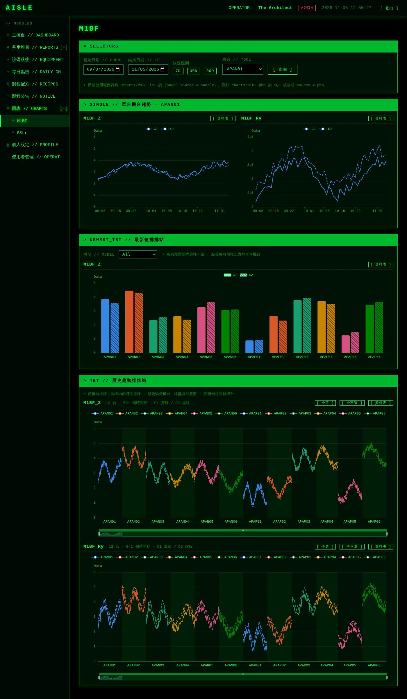
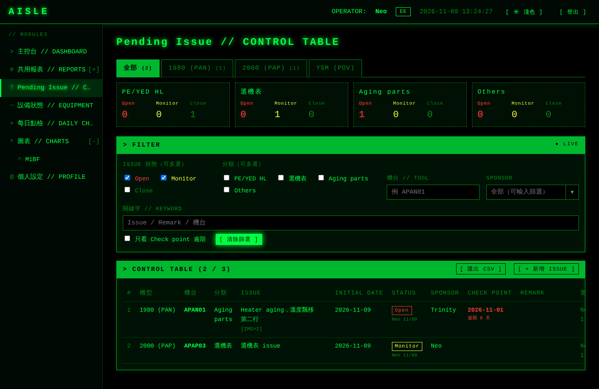
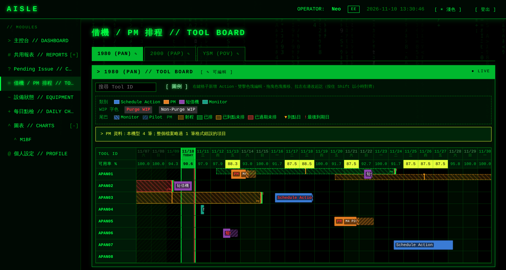
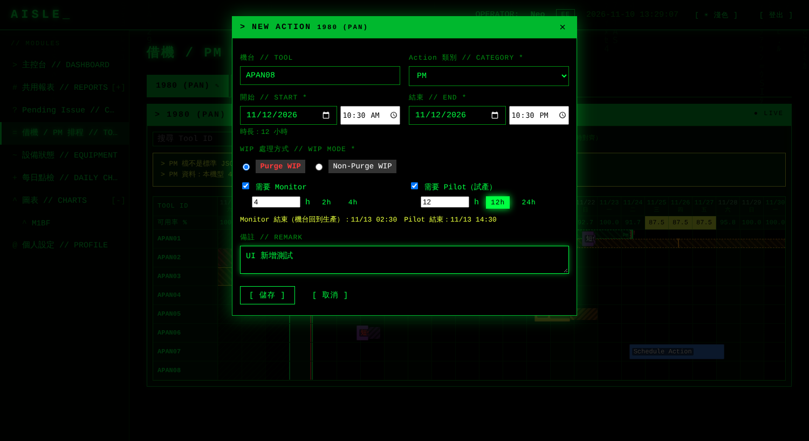

# AISLE 系統架構

多功能、模組化的內部網頁系統。依「身份」(EE / PE) 決定每位使用者能看到哪些功能頁面，介面採用駭客任務 (The Matrix) 綠色終端機風格。

| 層級 | 技術 | 備註 |
|---|---|---|
| 後端 | PHP 5.4 | 不使用 5.5+ 語法；資料庫一律 PDO prepared statement |
| 資料庫 | MariaDB 5.5 / 10.x | InnoDB、utf8mb4 |
| 輔助腳本 | Python 2.7、Bash | 權限檢查、建帳號、備份、產生模組 |
| 前端 | HTML5、jQuery 1.12.4、原生 Canvas | 不需要 Node / 建置工具 |

---

## 1. 資料夾結構

```
AISLE/
├── .htaccess                  # 整包放在網站目錄下時，把請求在內部轉進 public/
├── .gitignore
├── README.md
├── config/
│   ├── app.ini.example        # 主設定範本（DB 連線、安全參數）→ 複製成 app.ini
│   ├── config.ini             # ★ 身份 → 可用頁面清單、頁面路由、註冊名單
│   ├── pending_issue.ini      # Pending Issue 的機型、分類、Sponsor、匯出開關、同步秒數（見第 11 節）
│   ├── tool_board.ini         # 借機 / PM 看板共用設定：機型、類別顏色、可用率、PM JSON 路徑（見第 12 節）
│   └── tool_board/<機型>.ini  # 借機 / PM 看板各機型：機台清單、可編輯成員、WIP 處理方式
├── charts/                    # ★ 每張圖表兩個同名檔案（見第 10 節）
│   ├── _template.ini / .php   #   新圖表範本（_ 開頭不會被當成圖表）
│   └── M1BF.ini / M1BF.php    #   範例：<名稱>.ini 畫什麼、<名稱>.php 寫 SQL
├── core/                      # 框架核心（一般開發不需修改）
│   ├── bootstrap.php          # 載入類別、設定、Session
│   ├── auth_check.php         # ★ 共用權限檢查：所有功能頁面都經過這裡
│   ├── App.php                # 路由：index.php?m=<頁面>&a=<動作>，依 config.ini 的 route 載入
│   ├── Acl.php                # 讀 config.ini，判斷權限、產生選單
│   ├── Auth.php               # 登入 / 登出 / 失敗鎖定 / 閒置登出
│   ├── Registration.php       # 註冊驗證、依 EE 名單判定身份
│   ├── guard.php              # 頁面內細部判斷 require_role() / has_role() / csrf_field() …
│   ├── password_compat.php    # PHP 5.4 補上 password_hash() / password_verify()
│   ├── Password.php           # 包裝 password_hash()，成本讀 app.ini
│   ├── Security.php           # 安全亂數、常數時間比較、CSRF
│   ├── Database.php           # PDO 單例 + 查詢捷徑
│   ├── Controller.php         # 模組 Controller 基底類別
│   ├── View.php               # 純 PHP 樣板
│   └── helpers.php            # e() js() url() asset() audit() 等
├── modules/                   # 功能模組（route = "module:<資料夾>"）
│   ├── _template/             # 新模組樣板（_ 開頭不會被路由）
│   ├── dashboard/             # EE + PE
│   ├── shared_report/         # EE + PE（匯出限 PE，示範動作層級權限）
│   ├── profile/               # EE + PE（改密碼）
│   ├── ee_equipment/          # 只有 EE（示範 jQuery AJAX 刷新）
│   ├── pe_recipe/             # 只有 PE
│   ├── charts/                # 所有圖表共用（ECharts + AJAX，見第 10 節）
│   ├── pending_issue/         # Pending Issue Control Table，只有 EE（見第 11 節）
│   ├── tool_board/            # 機台借機與 PM 排程看板，EE 編輯 / PE 唯讀（見第 12 節）
│   └── admin_users/           # 只有 ADMIN（建帳號、停用、重設密碼）
│       ├── controller.php     #   class AdminUsersController extends Controller
│       └── views/index.php    #   該模組的畫面
├── pages/                     # 一般 PHP 頁面（route = "pages/xxx.php"）
│   ├── ee_daily_check.php     #   範例：只有 EE
│   ├── report_daily.php       #   範例：選單分類「共用報表」底下的 Report2
│   └── report_weekly.php      #   範例：選單分類「共用報表」底下的 Report3
├── templates/
│   ├── layout.php             # 共用版面（頂部列、側邊選單、數位雨背景）
│   ├── error.php
│   └── auth/                  # 登入、註冊頁面樣板
├── public/                    # ★ 唯一對外的目錄
│   ├── index.php              # 功能模組入口
│   ├── login.php              # 登入（GET 顯示 / POST 驗證，支援 AJAX）
│   ├── register.php           # 註冊（含帳號即時檢查）
│   ├── logout.php             # 登出（需 CSRF token）
│   ├── legacy/pe_notice.php   # 獨立頁面範例（route = "public/..."），第一行 require auth_check.php
│   ├── .htaccess
│   └── assets/
│       ├── css/matrix.css     # 駭客任務主題
│       ├── css/matrix-light.css # 淺色版（body.theme-light 時覆寫顏色）
│       ├── js/matrix-rain.js  # 數位雨 Canvas 動畫
│       ├── js/app.js          # jQuery 共用：CSRF、選單分類收折、打字機效果、時鐘
│       ├── js/auth.js         # 登入 / 註冊的前端驗證與非同步送出
│       ├── js/charts.js       # 圖表頁的 ECharts 繪圖（所有圖表共用）
│       └── vendor/            # jquery-1.12.4.min.js、echarts-5.4.3.min.js（執行 fetch_vendor.sh 下載）
├── scripts/
│   ├── python/check_config.py # 檢查 config.ini：身份、頁面、route 檔案、EE 名單
│   ├── python/make_update.py  # 產生單檔更新（在有 git 的電腦執行）
│   ├── python/apply_update.py # 在主機套用單檔更新，覆蓋前自動備份，可還原
│   └── shell/
│       ├── _common.sh         # 共用函式（讀 INI、產生暫存 mysql 設定）
│       ├── create_user.sh     # 建立使用者（互動輸入密碼）
│       ├── new_module.sh      # 由樣板產生新模組並登記到 config.ini
│       ├── new_chart.sh       # 由範本產生新圖表 charts/<名稱>.ini + .php（見第 10 節）
│       ├── backup_db.sh       # mysqldump 備份 + 自動清除舊檔
│       └── fetch_vendor.sh    # 下載 jQuery、ECharts
├── sql/
│   ├── schema.sql             # 建表
│   └── seed.sql               # 初始管理員
├── storage/
│   ├── logs/                  # PHP 錯誤紀錄（需可寫入）
│   └── backups/               # 資料庫備份
├── updates/                   # 單檔更新檔（見 docs/DEPLOY.md「不能 git pull 時的更新方式」）
└── docs/screenshots/          # 介面截圖
```

只有 `public/` 對外開放。目前部署方式是整包放在 `/var/www/html/aisle/`，經 proxy 對外為 `http://sccproxyauth-a-dc1-38.scc.f18.tsmc.com/D1C1/aisle/`：根目錄 `.htaccess` 把所有請求在內部轉進 `public/`，網址不會出現 `public/`，`config/`、`core/`、`modules/` 等經由網址存取一律 404。網頁內所有連結、轉址與 Session cookie 路徑都由 `config/app.ini` 的 `base_url`（`"/D1C1/aisle"`）產生。

---

## 2. 資料庫

`sql/schema.sql` 建立三張表：

| 資料表 | 用途 |
|---|---|
| `users` | 帳號 `account`、密碼雜湊 `password_hash`、身份 `role`、啟用狀態、失敗次數與鎖定時間、強制改密碼旗標、最後登入時間與 IP |
| `login_logs` | 每次登入嘗試（成功或失敗原因），供稽核與暴力破解追查 |
| `audit_logs` | 模組操作紀錄，例如匯出報表、建立帳號、重設密碼 |

設計重點：

- **`role` 用 VARCHAR 而非 ENUM**：新增身份只要改 `config.ini`，不必 `ALTER TABLE`。
- **`password_hash` 留 255 長度**：目前 bcrypt 固定 60 字元，保留未來更換演算法的空間。
- **`created_at` 用 DATETIME 由程式寫入**：MariaDB 5.5 一張表只能有一個 TIMESTAMP 使用 `CURRENT_TIMESTAMP`，這個位置留給 `updated_at`。
- 有索引的 VARCHAR 欄位長度 ≤ 191，避免舊版 InnoDB 在 utf8mb4 下超過 767 bytes 索引上限。

### 密碼雜湊（PHP 5.4 的做法）

`password_hash()` / `password_verify()` 是 PHP 5.5 才有的函式。`core/password_compat.php` 在函式不存在時補上同名函式：以 `crypt()` 搭配 `$2y$` bcrypt（PHP ≥ 5.3.7 支援），鹽來自 `openssl_random_pseudo_bytes`，驗證時使用常數時間比較。因此程式碼照標準 API 寫 `password_hash($pw, PASSWORD_BCRYPT)`，在 PHP 5.4 與 5.5+ 都能執行，雜湊格式也完全相同；日後升級 PHP 只要刪掉這個檔案，舊密碼不需重設。

---

## 3. 身份 → 頁面權限與路由（`config/config.ini` + `core/auth_check.php`）

### config.ini

```ini
[roles]
EE    = "EE 工程師"
PE    = "PE 工程師"
ADMIN = "系統管理員"

; ★ 身份 → 可用頁面清單。同一頁面同時列在 EE 與 PE 就是兩者都能看；"*" = 全部
[access]
EE    = "dashboard, shared_report, report_daily, report_weekly, ee_equipment, ee_daily_check, profile"
PE    = "dashboard, shared_report, report_daily, report_weekly, pe_recipe, pe_notice, profile"
ADMIN = "*"

; ★ 選單分類（選用）：可收折，頁面寫 group = "report" 就收在這底下
[group.report]
title = "共用報表 // REPORTS"
order = 20
open  = Off                           ; 預設收起；瀏覽器會記住使用者的展開狀態

; ★ 頁面與路由
[page.shared_report]
title = "Report1 // 綜合報表"
route = "module:shared_report"        ; modules/shared_report/controller.php
group = "report"
order = 1                             ; 分類內的排序
action.export = "PE"                  ; EE、PE 都能看，只有 PE 能匯出

[page.report_daily]
title = "Report2 // 日報"
route = "pages/report_daily.php"
group = "report"
order = 2

[page.ee_daily_check]
title = "每日點檢 // DAILY CHECK"
route = "pages/ee_daily_check.php"    ; 一般 PHP 頁面

[page.pe_notice]
title = "製程公告 // NOTICE"
route = "public/legacy/pe_notice.php" ; 既有的獨立頁面
```

選單分類只影響顯示：權限仍由 `[access]` 決定，某身份在分類裡看不到任何頁面時整個分類不會出現；目前所在頁面的分類一律展開；沒寫 `group` 的頁面照舊單層顯示。

`route` 有三種寫法：

| route | 程式位置 | 網址 | 適合 |
|---|---|---|---|
| `module:<資料夾>` | `modules/<資料夾>/controller.php` | `index.php?m=<代號>&a=<動作>` | 有多個動作、AJAX 的功能 |
| `pages/xxx.php` | `pages/xxx.php` | `index.php?m=<代號>` | 單純頁面，不用寫 Controller，自動套用版面 |
| `public/xxx.php` | `public/xxx.php` | 直接開啟該檔案 | 既有網站的舊頁面，只需在第一行加一行 require |

### auth_check.php：所有頁面共用同一套檢查

```
使用者開啟頁面
  ├─ index.php?m=xxx  →  App 路由 ──────────┐
  └─ public/legacy/xxx.php（第一行 require）─┤
                                             ▼
                              core/auth_check.php
                    1. 未登入           → 導向 login.php（AJAX 回 401）
                    2. 頁面未登記在 config.ini → 403
                    3. 首次登入未改密碼 → 導向個人設定
                    4. 身份不在 [access] 清單、或不符 action.* → 403
                                             ▼
                          通過 → 依 route 載入頁面程式
```

既有頁面接上權限只要在第一行加入（依檔案位置調整 `../`）：

```php
<?php require_once dirname(__FILE__) . '/../../core/auth_check.php';
// 通過檢查後才會執行到這裡；可用 $AUTH_USER、$AUTH_PAGE
```

auth_check.php 用「目前執行的檔案」對照 config.ini 的 route 找出頁面代號，所以頁面本身不用寫自己的代號或身份。檔案若沒登記在 config.ini，即使加了 require 也一律拒絕，避免漏設權限的頁面被看到。獨立頁面送出 POST 時會檢查 CSRF，舊表單請加上 `<?php echo csrf_field(); ?>`；若一時無法修改，可把 `[settings] direct_page_csrf` 設為 `Off`。

權限一律在伺服器端檢查，隱藏選單只是介面效果；直接輸入網址也會得到 403。目前範例的結果：

| 頁面 | EE | PE | ADMIN |
|---|:-:|:-:|:-:|
| 主控台 dashboard | ✓ | ✓ | ✓ |
| 共用報表 › Report1 shared_report | ✓（不可匯出） | ✓ | ✓ |
| 共用報表 › Report2 report_daily、Report3 report_weekly（pages/） | ✓ | ✓ | ✓ |
| 個人設定 profile | ✓ | ✓ | ✓ |
| 設備狀態 ee_equipment | ✓ | | ✓ |
| 每日點檢 ee_daily_check（pages/） | ✓ | | ✓ |
| 製程配方 pe_recipe | | ✓ | ✓ |
| 製程公告 pe_notice（獨立頁面） | | ✓ | ✓ |
| 圖表 › M1BF m1bf（module:charts） | ✓ | ✓ | ✓ |
| 使用者管理 admin_users | | | ✓ |

修改 config.ini 後執行 `python scripts/python/check_config.py`，會列出每個身份可用的頁面，並檢查拼字、route 檔案是否存在、獨立頁面有沒有 require auth_check.php。

---

## 4. 註冊、登入、登出與權限檢查

### 流程

| 檔案 | 方法 | 行為 |
|---|---|---|
| `public/register.php` | GET | 註冊頁 |
| | GET `?check_account=xxx`（AJAX） | 回傳帳號是否可用 |
| | POST | 驗證 → 依 EE 名單判定身份 → 寫入 `users`，並在 `audit_logs` 記錄身份來源 |
| `public/login.php` | GET / POST | 驗證帳密，成功後 `session_regenerate_id()` 並把使用者與身份寫入 `$_SESSION['user']` |
| `public/logout.php` | POST（或 `?_csrf=`） | 清除 Session 與 Cookie，導回 `login.php?bye=1` |

登入與註冊表單由 `js/auth.js` 以 jQuery 做即時驗證，並用 `$.ajax` 非同步送出，伺服器回 JSON。瀏覽器關閉 JavaScript 時表單照常以一般 POST 送出，伺服器端也會做完整驗證。

### 註冊時的身份判定（`config.ini` 的 `[register]` 與 `[ee_accounts]`）

註冊表單只填帳號、顯示名稱與密碼。身份在註冊當下依 INI 名單判定，直接寫入 `users.role`：

```ini
[register]
enabled          = On
require_approval = Off     ; On = 註冊後需管理員啟用
listed_role      = "EE"    ; 名單上的帳號
unlisted_role    = "PE"    ; 名單外的帳號；設為 "" 則名單外不能註冊

[ee_accounts]              ; EE 正面表列，一行一個帳號，不分大小寫
account[] = "neo"
account[] = "trinity"
```

- 名單只在註冊時讀取。之後增減名單，不會改變已經註冊的人的身份，要調整請直接改資料庫的 `users.role`。
- ADMIN 永遠無法經由註冊取得；`listed_role`、`unlisted_role` 若設成 superuser 角色會被忽略。
- `audit_logs` 會記錄每個帳號的身份來源（`ee_accounts` 或 `unlisted_role`）。
- 改完名單可以執行 `python scripts/python/check_config.py`，它會列出名單內容，並檢查帳號格式與重複。

### 共用權限檢查函式（`core/guard.php`）

```php
require_login();                    // 未登入 → 導向 login.php；AJAX 回 401
require_role('PE');                 // 身份不符 → 403（ADMIN 一律通過）
require_role('EE,PE');              // 多個身份用逗號
if (has_role('EE,PE')) { ... }      // 只判斷、不中止
if (can_access('shared_report', 'export')) { ... }   // 依 [access] 與 [page.xxx] 判斷
echo csrf_field();                  // 表單的 CSRF 隱藏欄位
current_user();  current_role();  is_logged_in();
```

頁面層級的權限由 `auth_check.php` 處理；這些函式用在頁面內更細的判斷，例如只對某身份顯示某個按鈕。

---

## 5. 新增功能頁面

只需要改 config.ini，核心程式（`core/`）不用動：

1. 放好頁面程式（擇一）：`pages/xxx.php`、`public/xxx.php`（第一行 require auth_check.php），或建立模組
2. 在 `[access]` 把頁面代號加進能使用它的身份
3. 新增 `[page.xxx]`，寫上 `title` 與 `route`
4. （選用）要放進選單分類就加上 `group = "<分類代號>"`；新分類再加一段 `[group.<分類代號>]`

例：新增一個 EE、PE 都能看的聯絡人頁面

```ini
[access]
EE = "dashboard, ..., team_contacts"
PE = "dashboard, ..., team_contacts"

[page.team_contacts]
title = "聯絡人 // CONTACTS"
route = "pages/team_contacts.php"
order = 60
```

需要多個動作或 AJAX 時用模組，腳本會產生程式骨架並自動完成上面第 2、3 步：

```bash
# 產生 modules/ee_alarm/，加入 EE、PE 的 [access] 清單並新增 [page.ee_alarm]
bash scripts/shell/new_module.sh ee_alarm "EE,PE" "警報中心 // ALARMS" 35
```

產生的骨架：

```php
<?php
class EeAlarmController extends Controller
{
    public function indexAction()          // index.php?m=ee_alarm
    {
        $this->render('index', array('message' => '...'));
    }

    public function listAction()           // index.php?m=ee_alarm&a=list
    {
        $rows = Database::fetchAll('SELECT ... WHERE x = ?', array($x));
        $this->json(array('ok' => true, 'rows' => $rows));
    }
}
```

Controller 可用的方法：`render()`、`json()`、`redirect()`、`can('動作')`、`isPost()`、`input()`、`query()`、`flash()`。View 中輸出變數一律用 `e($var)`；要放進 `<script>` 用 `js($var)`。

---

## 6. 安全機制

- bcrypt 密碼雜湊，提高 `bcrypt_cost` 後使用者下次登入自動升級雜湊
- 連續失敗 5 次鎖定 15 分鐘（`app.ini` 可調），帳號不存在時也執行一次 bcrypt，避免從回應時間猜出帳號
- 登入成功 `session_regenerate_id()`，閒置 30 分鐘自動登出，Cookie 設 HttpOnly
- 所有 POST（含 jQuery AJAX，透過 `X-CSRF-Token` 標頭）都檢查 CSRF token；登出也需要 token，避免被外部連結強制登出
- 註冊無法取得 ADMIN 身份；可開啟 `require_approval` 讓新帳號需管理員啟用，或把 `unlisted_role` 設為空字串只開放名單內帳號註冊
- 首次登入或被管理員重設密碼後強制改密碼
- 所有 SQL 使用 PDO prepared statement，`ATTR_EMULATE_PREPARES = false`

---

## 7. PHP 5.4 相容規範

可以用：`array()` 與 `[]` 短陣列、closure、`http_response_code()`、`JSON_UNESCAPED_UNICODE`、`session_status()`。

不能用：

| 不能用 | 版本 | 替代寫法 |
|---|---|---|
| `password_hash()` / `password_verify()` | 5.5 | 已由 `core/password_compat.php` 補上，可直接使用 |
| `finally`、`yield`、`::class`、`array_column()`、`empty(函式())` | 5.5 | try/catch、迴圈、字串類別名稱、先存變數 |
| `hash_equals()`、`...$args`、`const` 運算式 | 5.6 | `Security::equals()` |
| `??`、`<=>`、純量 type hint、回傳型別、`random_bytes()` | 7.0 | `array_get()`、`Security::randomBytes()` |
| `?->`、`match`、`fn() =>` | 8.0 | 一般寫法 |

---

## 8. 部署步驟

完整的逐步說明（環境需求、Apache 設定、驗證方式）見 [docs/DEPLOY.md](docs/DEPLOY.md)。順序摘要：

1. 確認 PHP 5.4（pdo_mysql、openssl）、MariaDB、Apache、Python 2.7
2. `git clone -b main` 到 `/var/www/html/aisle/`
3. `mysql -u root -p < sql/schema.sql`
4. 建立 `aisle_app` 資料庫帳號
5. `mysql -u root -p < sql/seed.sql`
6. `config/app.ini`（複製範本，填 DB 帳密，`base_url = "/D1C1/aisle"`）
7. `config/config.ini`（EE 名單、註冊設定、各身份頁面）
8. `python scripts/python/check_config.py`
9. `bash scripts/shell/fetch_vendor.sh`（下載 jQuery、ECharts）
10. 目錄權限（storage 可寫）
11. Apache 開啟 `mod_rewrite`，`/var/www/html/aisle` 設 `AllowOverride All`
12. 經 proxy 確認網址正常、設定檔無法從網址下載
13. `admin` / `Neo@Zion2026` 首次登入並改密碼
14. 註冊測試帳號，驗證 EE / PE 權限
15.（選用）接入既有舊頁面
16. 設定每日備份 crontab

---

## 9. 駭客任務主題

| 元素 | 檔案 | 說明 |
|---|---|---|
| 數位雨背景 | `js/matrix-rain.js` | Canvas 半形片假名雨，約 20fps；系統設定「減少動態」時改為靜態畫面 |
| CRT 掃描線 | `css/matrix.css` `.crt-overlay` | 全畫面細橫線疊層 |
| 終端機面板 | `.panel` `.terminal` | 綠框黑底、亮綠標題列 |
| 打字機效果 | `AISLE.typewriter()` | 登入頁標語、主控台訊息 |
| 標題故障效果 | `.glitch` | 滑鼠移上時文字抖動 |
| 狀態燈 | `.led-run/idle/down` | 綠、暗綠、閃爍紅 |
| 身份徽章 | `.role-EE/PE/ADMIN` | EE 亮綠、PE 薄荷綠、ADMIN 紅藥丸 |

色票：`#00ff41` 主綠、`#00b82e` 中綠、`#008f11` 暗綠、`#001a07` 面板底、`#ff3b3b` 警示紅。CSS 未使用 CSS 變數，以相容較舊的瀏覽器。

截圖見 `docs/screenshots/`。

### 風格切換（深色 / 淺色）

上方列（登入、註冊頁在右上角）有 `[ ☀ 淺色 ]` / `[ ☾ 深色 ]` 按鈕，可在「駭客任務」與「淺色底的駭客任務」之間切換，不用重新整理。

| 項目 | 說明 |
|---|---|
| 預設 | 深色（駭客任務） |
| 記憶方式 | cookie `aisle_theme`（`light` / 沒有＝深色），path 為 `base_url` + `/`，一年；每台電腦各自記憶，不寫資料庫 |
| 套用 | PHP 的 `current_theme()` 讀 cookie，`templates/layout.php` 輸出時就在 `<html>`、`<body>` 加上 `theme-light`，換頁不會閃爍 |
| 樣式 | `css/matrix-light.css` 全部是 `body.theme-light ...` 覆寫規則，`matrix.css` 本身不變 |
| 數位雨 / 圖表 | `matrix-rain.js` 依 body class 換色；`charts.js` 收到 `aisle:theme` 事件後換配色並用快取重畫 |

淺色版色票：`#f2fbf4` 底色、`#00591a` 主文字、`#008f11` 強調、`#2e6b3c` 次要文字、`#c62828` 警示紅。
新頁面請不要在 HTML 寫死顏色（`style="color:..."`），改用 class，淺色版才會跟著變。

---

## 10. 圖表（charts）

多張圖表（BSLr、M1BF、CDM、BMMF…）共用同一個模組 `modules/charts`，每張圖表是選單「圖表 // CHARTS」底下的一頁。圖表使用 ECharts 5.4.3（`public/assets/vendor/` 有檔案時用本機的，否則走 jsDelivr CDN）。

每張圖表只由兩個同名檔案定義，新增圖表不需要改任何程式：

| 檔案 | 內容 |
|---|---|
| `charts/<名稱>.ini` | 畫什麼、怎麼畫：`[page]` 整頁設定、`[plot.<代號>]` 每組圖 |
| `charts/<名稱>.php` | 部署者寫 SQL，整理成資料格式（`class <名稱>Chart extends ChartSource`） |
| `config/config.ini` | `[page.<小寫名稱>]`，`route = "module:charts"`、`group = "charts"`；哪些身份看得到寫在 `[access]` |

頁面代號 = 圖表名稱轉小寫：`[page.bslr]` → `charts/BSLr.ini`、`charts/BSLr.php`，網址 `index.php?m=bslr`。

| 區塊 | 內容 |
|---|---|
| 全域選擇器 | 起訖日期（快捷按鈕由 `quick_days` 設定）、單台機台 |
| single 單台機台趨勢 | 所選機台，每組一張圖，組內每個參數一條線；X 軸時間 |
| Newest_TBT 最新值排排站 | 每組一張長條圖，X 軸機台、每個參數一根長條，取每台在區間內的最後一個值；機型篩選（`model.<機型>`）；點長條會切換上方的單台機台 |
| TBT 歷史趨勢排排站 | 每組一張圖，每台一個區段（依機台名稱排序），區段內依時間排序；圖例可開關機台，下方可拖曳縮放 |

### 新增一張圖表

```bash
bash scripts/shell/new_chart.sh CDM      # 建立 charts/CDM.ini、charts/CDM.php，並印出 config.ini 要貼的區段
```

1. 編輯 `charts/CDM.ini` 的 `[plot.xxx]`；此時 `source = sample`，用範例資料就能看到完整畫面
2. 編輯 `charts/CDM.php` 寫 `tools()`、`series()` 的 SQL，寫好把 ini 改成 `source = php`
3. 把腳本印出的 `[page.cdm]` 貼進 `config/config.ini`，並把 `cdm` 加到 `[access]` 要看得到的身份
4. `python scripts/python/check_config.py` 檢查

### 設定檔：`charts/<名稱>.ini`

```ini
[page]
source       = php          ; php = 用 <名稱>.php 查資料庫；sample = 內建範例資料
default_days = 60           ; 預設顯示最近幾天
max_days     = 366          ; 一次最多查幾天
quick_days   = "7, 30, 90"  ; 快速區間按鈕
model.1980   = "PAN"        ; 機台代號含 PAN → 機型 1980（不設定就沒有機型下拉選單）
model.2000   = "PAP"

[db]                        ; 這張圖表的資料庫連線；ip 留空 = 使用 AISLE 自己的資料庫
ip       = "10.x.x.x"       ; 帳號密碼只填在主機上，repo 裡一律留空
port     = 3306
name     = "資料庫名稱"
user     = "唯讀帳號"
password = "密碼"
charset  = "utf8mb4"

[plot.m1bf_z]
title  = "M1BF_Z"
params = "M1BF_Z_C1, M1BF_Z_C2"   ; 畫在同一張圖的參數
single = On                        ; 是否畫單台機台趨勢
newest = On                        ; 是否畫最新值排排站
tbt    = On                        ; 是否畫歷史趨勢排排站
ymin   = 0                         ; Y 軸下限（三張圖共用）
ymax   = 6                         ; Y 軸上限（三張圖共用）
newest_ymax = 5                    ; 只改最新值排排站的上限
upper_oos = 5                      ; spec 線（可留空 = 不畫）
upper_ooc = 4.5
lower_ooc = 1
lower_oos = 0.5

[plot.m1bf_ry]
title  = "M1BF_Ry"
params = "M1BF_Ry_C1, M1BF_Ry_C2"
newest = Off                       ; 這組不顯示最新值排排站
tbt_ymin = 0                       ; 只設歷史趨勢排排站的上下限，單台趨勢維持自動
tbt_ymax = 6
```

- 每個 `[plot.<代號>]` 是一組，頁面依檔案順序畫圖；`single` / `newest` / `tbt` 省略時為 On
- 某區塊沒有任何一組開啟時，整個區塊不顯示
- 可選 `unit` 設定 Y 軸名稱（預設 `Data`）；`connect = On` 讓線跨過空值連起來（參數來自取樣時間不同的 table 時使用）
- Y 軸上下限：`ymin` / `ymax` 套用到該組三張圖；`single_ymin`、`newest_ymax`、`tbt_ymin` 等只套用到該區塊並優先；不設或留空為自動，超出範圍的資料會被裁切
- spec 線：`upper_oos` / `upper_ooc` / `lower_ooc` / `lower_oos`，可省略或留空（不畫）。三個區塊都畫成水平線，OOS 紅色實線、OOC 橘色虛線；有填的值須符合 `lower_oos <= lower_ooc < upper_ooc <= upper_oos`。Y 軸自動時會把 spec 線納入範圍
- 存檔後重新整理頁面即生效；格式錯誤時頁面會顯示錯誤（`modules/charts/ChartConfig.php` 檢查）

### 資料來源：`charts/<名稱>.php`

```php
<?php
class BSLrChart extends ChartSource
{
    public function tools()
    {
        $rows = $this->fetchAll('SELECT DISTINCT tool_id FROM bslr_x_data');
        $tools = array();
        foreach ($rows as $r) {
            $tools[] = $r['tool_id'];
        }
        return $tools;
    }

    public function series($tools, $params, $start, $end)
    {
        $where = 'tool_id IN (' . $this->in($tools) . ')
                  AND data_time >= ? AND data_time < DATE_ADD(?, INTERVAL 1 DAY)';
        $bind  = array_merge($tools, array($start, $end));

        // 長表（tool_id, data_time, param, value）
        $a = self::pivot($this->fetchAll(
            'SELECT tool_id, DATE_FORMAT(data_time, \'%Y-%m-%d %H:%i:%s\') AS d, param, value
               FROM bslr_x_data WHERE ' . $where, $bind), 'tool_id', 'd', 'param', 'value');

        // 寬表，欄位 c1 / c2 對應參數 BSLr_Y_C1 / BSLr_Y_C2
        $b = self::wide($this->fetchAll(
            'SELECT tool_id, DATE_FORMAT(data_time, \'%Y-%m-%d %H:%i:%s\') AS d, c1, c2
               FROM bslr_y_summary WHERE ' . $where, $bind),
            'tool_id', 'd', array('BSLr_Y_C1' => 'c1', 'BSLr_Y_C2' => 'c2'));

        return self::merge($a, $b);   // 不同 table 的結果依機台 + 時間合併
    }
}
```

| 工具（`modules/charts/ChartSource.php`） | 用途 |
|---|---|
| `$this->fetchAll($sql, $bind)` | prepared statement 查詢，值一律用 `?` 綁定 |
| `$this->in($list)` | 產生 `IN (...)` 用的 `?,?,?` |
| `self::pivot($rows, 機台欄, 時間欄, 參數欄, 值欄)` | 長表（一列一個參數值）→ 資料格式 |
| `self::wide($rows, 機台欄, 時間欄, 參數 => 欄位)` | 寬表（每個參數一個欄位）→ 資料格式 |
| `self::merge($a, $b, ...)` | 多個 table 的結果合併，對不到的位置補 null |
| `$this->machineOf($tool)` / `$this->machinesOf($tools)` / `$this->toolOf($machine)` | tool_id 與 machine_id 互換（要先實作 `machines()`） |
| `self::table($name)` | 組出來的 table 名稱（例 `'M1BF_' . $machineId`）檢查後加反引號；table 名稱不能用 `?` 綁定，一定要經過它 |

**table 用 machine_id 時**（例 table `M1BF_HP23`，`HP23` 是 `APAN01` 的 machine_id）：在 `<名稱>.php` 實作 `machines()`，回傳 `array('APAN01' => 'HP23', ...)`（可寫死或從對照表查）。實作後 `tools()` 可以省略（預設用 `machines()` 的 tool_id），`series()` 回傳的 key 也可以直接是 machine_id，controller 會自動換成 tool_id；網頁上的機台名稱一律是 tool_id。範例見 `charts/_template.php` 的寫法 4（每台一個 table）、寫法 5（machine_id 欄位）。

資料庫連線在各圖表自己的 `charts/<名稱>.ini` 的 `[db]`（ip / port / name / user / password / charset）；`ip` 留空時使用 AISLE 自己的 `[database]`。帳號密碼只在主機上的檔案填寫，**不要 commit 到 GitHub**（repo 裡一律留空）。`charts/` 從網址讀不到（根目錄 `.htaccess`），`[db]` 也不會送到瀏覽器。

### 資料格式與載入

後端 `index.php?m=<頁面代號>&a=tbt&start=&end=` 回傳區間內全部機台、ini 用到的全部參數：

```json
{
  "APAN01": { "Date": ["2026-01-01", "2026-01-02"],
              "Data": { "M1BF_Z_C1": [1.0, 2.0], "M1BF_Z_C2": [1.1, 2.1], "M1BF_Ry_C1": [1.0, 2.0], "M1BF_Ry_C2": [1.1, 2.1] } }
}
```

- 選用 `"Url": [...]`（與 `Date` 等長）：單台機台趨勢圖點擊數據點會在瀏覽器新分頁開啟該時間點的網址，tooltip 會提示「點擊數據點開啟連結」，資料表多一欄 URL。只接受 `http://`、`https://` 或 `/` 開頭的網址（其他如 `javascript:` 一律忽略）；`pivot()` / `wide()` 最後多給網址欄位名稱即可產生，`merge()` 會保留。沒有 `Url` 時與原本相同
- 每個參數陣列與 `Date` 等長，沒有值的位置是 `null`；排序、型別、補 null、只留 ini 用到的參數由 controller 統一處理，`<名稱>.php` 不需要先排好
- 進入頁面時只呼叫一次，所有圖都從這份資料取得。切換機台、切換機型只在瀏覽器端重畫，不再向後端要資料；只有改日期區間（查詢 / 快速區間）才重新取
- 編碼：**顏色 = 機台**（同機型內依序取色，跟著機台走，篩選後不變）、**線型 / 長條紋理 = 參數**（組內第 1 個參數實線，第 2 個虛線、斜線紋理…）
- 每張圖都有「資料表」按鈕可切換成表格檢視
- 錯誤處理：設定錯誤直接顯示在頁面上；資料庫 / SQL 錯誤只在 `debug = 1` 時顯示內容，否則寫到 PHP error log



## 11. Pending Issue Control Table（`?m=pending_issue`）

追蹤各機台的 pending issue。只有 **EE** 能進入：所有 EE 都能查詢、匯出；**新增、編輯（含上傳圖片）只限列在 `config/pending_issue.ini` `[editors]` 的 EE 帳號**，其他 EE 打開 issue 是唯讀；**刪除只有 ADMIN**。**ADMIN** 全部可以（含刪除、看已刪除、還原），PE 看不到選單、直接開網址會 403。

| 檔案 | 用途 |
|---|---|
| `config/config.ini` `[page.pending_issue]` | 頁面登記；`action.delete` / `action.trash` / `action.restore` = `"ADMIN"`（刪除、看已刪除、還原） |
| `config/pending_issue.ini` | 可新增 / 編輯的 EE 帳號（`[editors]`）、機型、分類、狀態名稱、Sponsor 身份、匯出開關、圖片上限、輪詢 / 閒置秒數 |
| `modules/pending_issue/` | controller + view |
| `public/assets/js/pending_issue.js` | 表格、篩選、Sponsor 元件、貼圖、輪詢、衝突視窗 |
| `sql/migrations/20261110_pending_issue.sql` | 建表（`pending_issues`、`pending_issue_status_logs`、`pending_issue_images`、`pending_issue_presence`） |
| `storage/uploads/pending_issue/<年月>/` | 圖片檔（網址無法直接讀取） |

**欄位**：機台（必填，機型依代號自動判定，例 `APAN01` → 1980 (PAN)）、機型、分類（PE/YED HL / 選機表 / Aging parts / Others）、Issue 描述（必填）、Initial date、狀態（Open / Monitor / Close）、Sponsor（AISLE 使用者）、Check point date、Remark、圖片。

**畫面**

- 上方機型頁籤（括號內是未結案筆數），下方是分類 × 狀態統計，點數字直接套用篩選
- 篩選：Issue 狀態（多選，預設 Open + Monitor）、分類（多選）、機台、Sponsor、關鍵字、只看 Check point 逾期；條件寫在網址上，重新整理或分享網址都會保留
- 點欄位標題排序（第三次點回預設：Open → Monitor → Close、Check point 早的在前）；Check point 已過且未 Close 顯示紅字「逾期 N 天」
- **Sponsor**：點 ▼ 展開清單，或直接打字篩選（比對帳號與顯示名稱、不分大小寫），↑↓ / Enter / Esc 操作；只能選清單裡的人（`[sponsor] roles` 的啟用帳號）
- **狀態紀錄**：每次狀態改變都寫進 `pending_issue_status_logs`（誰、何時、從哪個狀態），表格顯示最後改狀態的人，編輯視窗有完整歷程
- **圖片**：編輯視窗中 Ctrl+V 貼上截圖、拖曳或選檔；只收 PNG / JPG / GIF（以檔案內容判斷）。圖片經 `?a=image` 檢查權限後才輸出：未存檔的暫存圖只有上傳者、已刪除 issue 的圖只有 ADMIN 看得到
- **軟刪除（只有 ADMIN）**：刪除只標記 `deleted_at`；EE 的編輯視窗沒有刪除按鈕，直接呼叫也會 403。ADMIN 勾「顯示已刪除」後可以還原
- **匯出 CSV**：匯出目前篩選與排序的結果（UTF-8 BOM，Excel 直接開）；`[export] enabled = Off` 時按鈕隱藏、網址回 404
- **IE11**：開啟頁面時跳出警告視窗（IE11 無法貼上截圖，拖曳與選檔可用）

**多人同時操作**

- 樂觀鎖：每筆有 `version`，存檔時比對。別人先存過 → 回 409，視窗列出「你的版本 / 最新版本」不同的欄位，可選 **覆蓋（用我的版本）**、**載入最新** 或取消。覆蓋時仍會比對版本，不會蓋掉自己沒看過的第三人修改
- 每 `poll_seconds`（預設 10）秒輪詢一次，同步別人的新增 / 修改 / 刪除，並顯示「某某 編輯中」；別人改了你正在編輯的那筆，視窗上方會立刻提示
- 閒置 `idle_seconds`（預設 300）秒沒操作，或分頁切到背景，就暫停輪詢（右上角顯示「⏸ 已暫停同步」），讓登入依 `session_idle` 照常逾時；有操作時立即恢復。不設人數上限



## 12. 機台借機與 PM 排程看板（`?m=tool_board`）

Tool Reservation & Maintenance Management Board。上方機型頁籤 **1980 (PAN) / 2000 (PAP) / YSM (POV)**，每個機型分開維護與設定；左欄 Tool ID，右邊是今天前 3 天到後 60 天（共 64 天）的日格子，第一列是該機型每日預估可用率。

| 檔案 | 用途 |
|---|---|
| `config/config.ini` `[page.tool_board]` | 頁面登記；EE、PE 都在 `[access]`；`action.save` / `action.move` / `action.delete` = `"EE"` |
| `config/tool_board.ini` | 共用：機型清單、時間視窗、格寬、預設起頭時間、Action 類別（名稱 / Hex 顏色 / 是否算停機 / 預設時數 / 預設 WIP）、可用率公式與門檻、PM JSON 路徑、輪詢秒數 |
| `config/tool_board/<機型>.ini` | 各機型：`[tools]` 機台清單、`[editors]` 可編輯的 EE 帳號、`[wip.<代碼>]` WIP 處理方式（名稱 / 字色 / 粗體）；也可覆蓋共用的 `[category.*]`、`[availability]` |
| `modules/tool_board/` | controller、設定讀取（BoardConfig）、可用率（Availability）、PM 讀取（PmSource）、view |
| `modules/tool_board/formulas/` | （選用）自訂可用率公式，一個公式一個檔 |
| `public/assets/js/tool_board.js` | 看板、右鍵選單、表單、拖曳、輪詢、衝突視窗 |
| `sql/migrations/20261111_tool_board.sql` | 建表（`tool_board_actions`、`tool_board_locks`、`tool_board_action_log`、`tool_board_presence`） |
| `storage/cache/` | PM JSON 解析快取（檔案改變才重新解析） |

**權限**

| 身份 | 看 | 新增 / 修改 / 拖曳 / 刪除 |
|---|---|---|
| ADMIN | 全部機型 | 全部機型 |
| EE（列在該機型 `[editors]`） | 全部機型 | 只有列名的機型（頁籤上有 ✎） |
| EE（沒列名）、PE | 全部機型 | 唯讀（雙擊色塊可檢視） |

後端每個寫入動作都會檢查，不只是隱藏按鈕。

**操作**

- 在格子上按右鍵 →「新增 Action」：類別、WIP 處理方式（單選，選項來自目前機型的 `[wip.*]`）、開始 / 結束（日期 + 時:分，新增時預帶點的那天 `default_start_time`，可自行調整；改開始時間時結束時間跟著平移、時長不變，手動改過結束就不再平移）、是否需要 Monitor（時數，快捷 2h / 4h）、是否需要 Pilot（時數，快捷 12h / 24h）、備註
- 色塊右鍵：編輯 / 複製 / 刪除；雙擊色塊 = 編輯；編輯視窗下方有異動紀錄（誰、何時、新增 / 修改 / 拖曳）
- **拖曳**：拖色塊中間 = 整段搬移；拖左右邊緣 = 改開始或結束（色塊太窄時只能整段搬移）。預設以「天」對齊（保留原本的時分），按住 **Shift** 以 1 小時對齊；拖曳時旁邊顯示即時起訖，重疊會變紅、放開後還原
- 開始時間最早只能到今天往前 3 天（`days_before`），方便補登實際時間；再更早的不能新增或修改

**畫法**

- 色塊背景色 = 類別的 `color`；文字色 = WIP 的 `text_color`（例 Purge WIP 紅字粗體）
- 有 Monitor / Pilot 時，色塊上顯示 `Mon: 4h | Pilot: 12h`（太窄時 `M4 P12`），並在 Action 結束後接著畫 Monitor 尾巴（深色斜線）、再畫 Pilot 尾巴（淡色斜線）
- 今天整欄醒目底色加粗框，紅色直線是「現在」；過去的日子加斜線底紋
- 同一台**不允許時間重疊**，判斷時包含 Monitor / Pilot 尾巴（伺服器檢查）

**每日預估可用率**

- 預設：`Σ(每台當天可用時數) / (該機型機台數 × 24h) × 100%`；停機時段 = `counts_down = On` 的類別的 Action 本體 ＋ Monitor 尾巴（`count_monitor`，預設算）＋ Pilot 尾巴（`count_pilot`，預設不算，因為 Pilot 有在跑貨）
- 低於 `warn_below`（90）黃底、低於 `alert_below`（80）紅底；滑鼠移上去顯示可用時數
- 換公式：在 `modules/tool_board/formulas/` 新增 `<名稱>.php`（`class <名稱>Availability extends AvailabilityFormula`），設定 `formula = "<名稱>"`，範例見該資料夾的 README.txt；機型檔可以各自指定

**PM 射程**

- `config/tool_board.ini` `[pm] json_path` 指定一個 JSON 檔（三個機型共用，各機型只顯示自己的機台）：
  ```json
  {"APAN01": {"PM":     {"window_start_date": "2026-06-01 09:30", "first_due": "2026-06-10 09:30", "due_date": "2026-06-17 09:30"},
              "AMC_PM": {"window_start_date": "2026-07-01 09:30", "first_due": "2026-07-10 09:30", "due_date": "2026-07-17 09:30"}}}
  ```
- 不匯入資料庫：每次讀取比對檔案修改時間與大小，有變才重新解析，下一次輪詢就更新所有人的畫面
- 產生端請用 Python `json.dump` 輸出；若是單引號（Python dict 印法，含 `u'..'`、`True/False/None`）也會自動轉換，但畫面會提示
- 格式錯誤的項目略過，畫面顯示略過筆數（原因只有 ADMIN 看得到）；檔案不存在或整個壞掉時看板照常運作，只顯示警告
- 畫法：射程（window_start_date → due_date）淡色斜線底帶、到點日 ▼ 橘線、最後到期日 ! 紅線；射程內已有 PM 類別的 Action → 綠色（已排），已到點未排 → 橘框，已過最後到期日未排 → 紅色閃爍
- 在射程上按右鍵「依此 PM 新增 Action」：類別帶 PM、開始時間 = 到點日、記下 PM 類型

**多人同時操作**（不需要 WebSocket，沿用 Pending Issue 的做法）

- 樂觀鎖：每筆有 `version`，存檔 / 拖曳 / 刪除時比對；別人先改過 → 409，視窗列出「你的版本 / 最新版本」，可選 **覆蓋（用我的版本）**、**使用最新版本** 或取消
- 重疊檢查在交易內先鎖住該機台（`tool_board_locks`），兩個人同時把不同 Action 排進同一段時間時，後到的會被擋下
- 每 `poll_seconds`（預設 5）秒輪詢：同步別人的新增 / 修改 / 拖曳 / 刪除、可用率、PM 檔更新；顯示同機型的線上使用者，以及「🔒 某某 編輯中 / 拖曳中」
- 閒置 `idle_seconds` 或分頁在背景時暫停輪詢，讓登入照常逾時
- IE11 開啟時跳出警告（拖曳在 IE11 無法正常使用）




